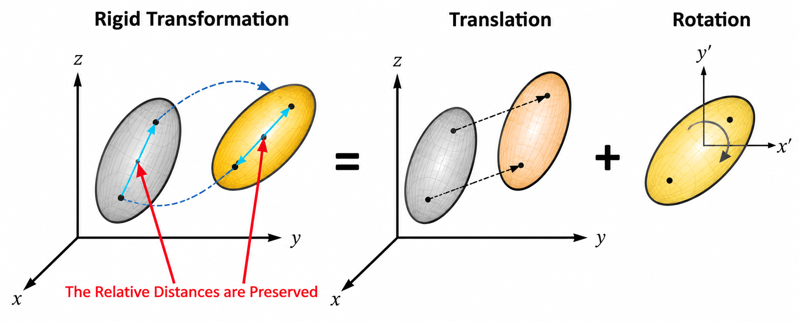

# Introduction


# Point Cloud

A point cloud is a collection of discrete 3D data points in space that together represent the external surface geometry of an object, building, or landscape. Every individual point is defined by Cartesian coordinates (X, Y, Z). The points can also store extra data like RGB color values, laser intensity, surface normals, or timestamps, namely "attributes".  Common formats to store a point cloud data include PLY, PCD, LAS, LAZ, E57, and OBJ. Some well-known sensors with the output data in the form of point clouds are: LiDAR Scanners, Radars, and RGB-D / Depth Cameras.

# Rigid Transformations

A rigid transformation is a geometric transformation that preserves distances, angles, and shapes (rigid). It is a combination of translation and rotation. In other words, when a figure undergoes a rigid transformation, it is translated and/or rotated without changing its orignial size or shape. This concept is shown in Fig. 1.

<p align="center">
  
</p>

<p align="center">
  <em>Figure 1: Rigid transformation = translation + rotation.</em>
</p>

For a 3D point $\mathbf{p}$, the transformed point $\mathbf{p}'$ is

$$
\mathbf{p}' = R\mathbf{p} + \mathbf{t}
$$

where

- $R \in \mathbb{R}^{3 \times 3}$ is the rotation matrix,
- $\mathbf{t} \in \mathbb{R}^{3}$ is the translation vector.

The rotation matrix satisfies

```math
R^T R = I
```

and

```math
\det(R) = 1
```

Therefore,

```math
R \in SO(3)
```

Using homogeneous coordinates, the rigid transformation can be written as

```math
T =
\begin{bmatrix}
R & \mathbf{t} \\
\mathbf{0}^T & 1
\end{bmatrix}
```

where $T \in SE(3)$.
